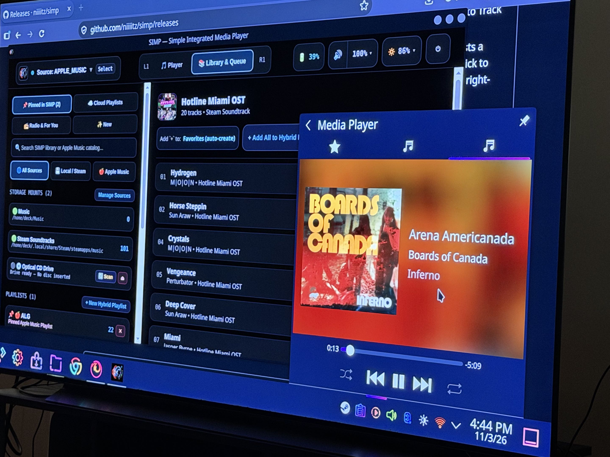
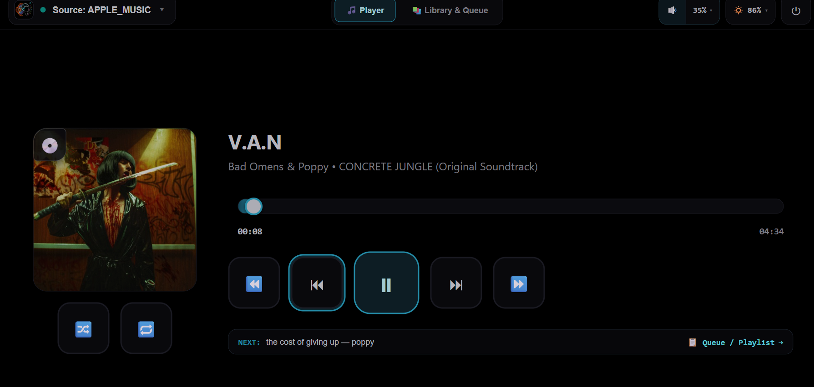
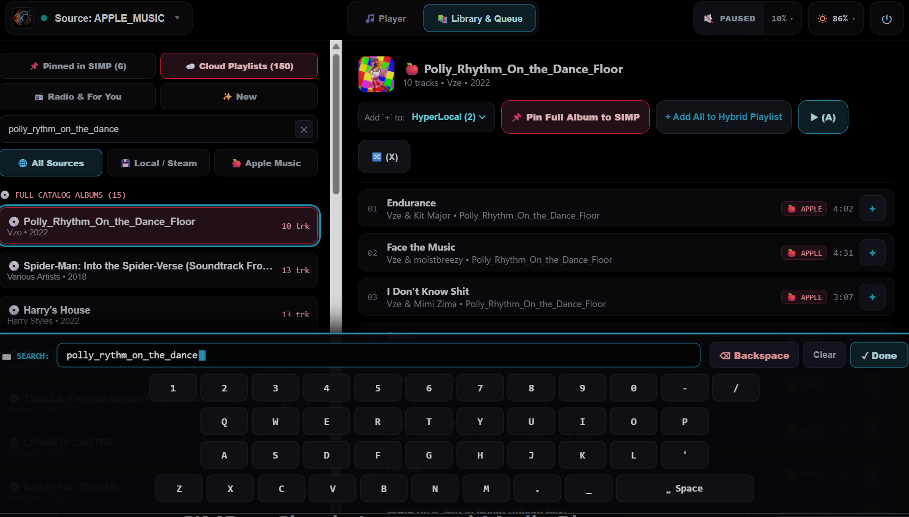

<div align="center">
  

  # SIMP — Simple Integrated Media Player

  **A lightweight, controller-friendly music player for SteamOS, Bazzite, Linux desktops, and SteamVR.**

  [](#)
  [](#)
  [](#)
</div>

---

## What is this?

If you use a Steam Deck, a living-room Bazzite box, or a Linux desktop, playing music while you game is weirdly annoying. You either have to keep a heavy web browser open in the background, juggle separate apps for local files and streaming, or squint at tiny desktop buttons that were never meant for a controller.

**SIMP** is a small, fast media player built to fix that. It runs a tiny Rust audio service in the background and gives you a clean, high-contrast console interface that works just as naturally with a gamepad or VR controller as it does with a mouse and keyboard.

| <a href="docs/screenshots/on_deck.jpg"></a> | <a href="docs/screenshots/spacial_computing_simp.jpg"></a> |
| :---: | :---: |
| **Steam Deck (Handheld Gamepad Mode)**<br><sub>Controller button hints (`L1`/`R1`/`X`/`Y`/`L2`/`R2`) active</sub> | **Steam Frame (`aarch64` SteamVR Spatial Overlay)**<br><sub>Floating alongside your VR library in passthrough/3D space</sub> |
| <a href="docs/screenshots/KDE_steammachine.jpg"></a> | <a href="docs/screenshots/library_queue.png"></a> |
| **KDE Plasma & Steam Machine**<br><sub>Local/Steam OST browser with native KDE `MPRIS2` tray controls</sub> | **Library & Cloud Playlists**<br><sub>Pinning iCloud Music Library playlists into SIMP</sub> |
| <a href="docs/screenshots/mouse_mode.png"></a> | <a href="docs/screenshots/search_and_pin.png"></a> |
| **Adaptive Pointer / Mouse Mode**<br><sub>Controller glyphs auto-hide when using a mouse or trackpad</sub> | **Catalog Search & Built-in Controller OSK**<br><sub>Full catalog search, album pinning, and on-screen keyboard</sub> |

---

## Highlights

* **One queue for everything:** Mix local audio files (`FLAC`, `MP3`, `WAV`, `OGG`, `OPUS`, `M4A`), your installed **Steam Soundtracks**, **Apple Music** streams, **SoundCloud** tracks & long-form DJ mixes, and even physical **Audio CDs** (via an external USB drive) inside the same playlist.
* **No background browser bloat:** Playback, library indexing, Apple Music streaming, and SoundCloud 160kbps AAC / 128kbps MP3 streaming run natively in a single ~4 MB Rust background daemon. Close the window to jump back into your game and your music keeps playing with `< 1%` CPU usage.
* **First-class SoundCloud experience:** Browse **Trending & 20m+ DJ Mixes**, genre vibes, your **Likes & Sets**, and **Activity Stream**, launch instant **Track Radio (`📻`)** stations, and toggle **ephemeral timed comment speech bubbles (`💬`)** and waveform silhouettes synced to the playhead.
* **Pin only what you care about:** Instead of dumping thousands of cloud tracks into your local library, you can browse your cloud playlists, radio stations, and catalog search results on demand, and **Pin** your favorites into SIMP for instant startup.
* **Adapts to your input:** Pick up a controller and button hints (`L1`, `R1`, `A`, `B`, `X`, `Y`) light up for couch/handheld navigation. Move your mouse on a desktop and the controller badges get out of the way automatically.
* **Built for OLED screens:** Pure `#000000` black backgrounds, subtle pixel-shifting, automatic idle dimming, and a one-tap sleep screen so you can leave your music up on an OLED display without worrying about burn-in.
* **Plays nice with your OS & VR:** Integrates natively with Linux media keys and system tray controls (`MPRIS2`) and registers a native SteamVR dashboard overlay (`libopenvr_api.so`) when SteamVR is running.

---

## Installation (SteamOS / Bazzite / Linux)

SIMP installs entirely into your home folder (`~/.local/share/simp`) and runs as a `systemd --user` service. It **never** requires disabling `steamos-readonly` or modifying system files.

Grab `simp-steamos-userland-x86_64.tar.gz` (or `simp-steamos-userland-aarch64.tar.gz` on **Steam Frame** / ARM64) from the [latest GitHub Release](https://github.com/niiiitz/simp/releases) and run:

```bash
rm -rf /tmp/simp-steamos-userland && tar -xzf simp-steamos-userland-x86_64.tar.gz -C /tmp
/tmp/simp-steamos-userland/install-steamos.sh
```

Once installed:
* **Launch:** Open **SIMP** from your desktop application menu, run `simp` in a terminal, or right-click **SIMP** in your app menu and select **Add to Steam** to launch it straight from Game Mode or SteamVR.
* **Update:** Run `simp update` in a terminal, or open the in-app Power menu (`⏻`) and click **Update SIMP**.
* **Uninstall:** Run `~/.local/share/simp/bin/uninstall-steamos.sh`.

> **Optional Decky Loader Plugin (Handheld Steam Deck):**
> SIMP works standalone and does **not** require Decky Loader. If you use Decky on a Steam Deck and want the optional Quick Access Menu drawer, you can install `simp-decky.zip` from the release page via Decky's *Install from ZIP* menu.

---

## Usage & Troubleshooting

### Signing into Apple Music (Use the QR Code or Desktop Mode)
Typing passwords and 2FA codes on a controller keyboard is no fun, and Steam's embedded Game Mode browser (`steamwebhelper`) has a known quirk ([#7](https://github.com/niiiitz/simp/issues/7)) where it blocks Apple's second "Allow access" confirmation popup.

To sign in smoothly (you only need to do this once):
1. Open **Sources (`Select`)** in SIMP.
2. Either scan the on-screen **QR Code** with your phone/PC on the same Wi-Fi network, **or** open `http://127.0.0.1:18888/pair` in Firefox/Chrome while in Desktop Mode.
3. Once signed in, your token is saved to `~/.config/simp/settings.vdf` and Apple Music will work automatically everywhere (including Game Mode).

### Controller Shortcuts

| Button | On the Player Screen (`L1`) | In Library & Queue (`R1`) |
| :--- | :--- | :--- |
| **`A` / `Enter`** | Play / Pause | Play selected track, press button, or open keyboard on search boxes |
| **`B` / `Esc`** | Close popups | Back out of menus / return to Player screen |
| **`X` / `Y`** | Toggle Shuffle (`X`) / Cycle Repeat (`Y`) | Toggle Shuffle (`X`) / Cycle Repeat (`Y`) |
| **`D-Pad Left / Right`** | Previous / Next track | Move between left and right columns |
| **`D-Pad Up / Down`** | Volume `+5%` / `-5%` | Scroll up and down lists |
| **`L1` / `R1` Bumpers** | Switch to Player (`L1`) / Library (`R1`) | Switch to Player (`L1`) / Library (`R1`) |
| **`L2` / `R2` Triggers** | Rewind `-10s` / Fast-Forward `+10s` | Rewind `-10s` / Fast-Forward `+10s` |
| **`Select` / `Start`** | Open Sources (`Select`) / Power Menu (`Start`) | Open Sources (`Select`) / Power Menu (`Start`) |

### Where Things Live & Common Fixes

* **Settings & Provisioning Config:** `~/.config/simp/settings.vdf` (Human-readable Valve VDF file holding your watched music folders, audio preferences, and CDM/update URLs).
* **Database & Cache:** `~/.local/share/simp/library.db` (SQLite database for local tracks, pinned cloud playlists, and cached Audio CD lookups).
* **Audio stops or daemon feels stuck:** Open the Power menu (`⏻`) inside SIMP and click **Restart Audio Daemon**, or run `systemctl --user restart simp.service`.
* **Checking logs:** Run `journalctl --user -u simp.service -f` to see live logs from the background player.
* **Optical Audio CDs & DVD-Video (`cdda://` / `dvd://`):** SIMP never polls `/dev/sr0` in the background (so your USB disc drive doesn't click or spin up randomly). Pop in an Audio CD or DVD-Video disc and click the **🔄 Scan** button on the Optical Disc entry under `▾ SIMP PLAYLISTS` (or inside **Sources**).
* **Encrypted Commercial DVD-Video Playback (`libdvdcss.so.2`):** SIMP does not bundle or redistribute `libdvdcss`. To play CSS-encrypted commercial DVDs (with multi-track audio and subtitle support), place your platform's `libdvdcss.so.2` (`x86_64` on Steam Deck / Linux Desktop, or `aarch64` on Steam Frame) into `~/.local/share/simp/lib/libdvdcss.so.2` (this userland path survives SteamOS system updates) or install your distro's `libdvdcss` package into `/usr/lib`. Video streaming uses `/usr/bin/ffmpeg` (pre-installed on SteamOS) or `~/.local/share/simp/bin/ffmpeg`.

---

## How It Works Under the Hood

SIMP is split into two pieces so the UI never weighs down your system:

1. **The Rust Background Daemon (`simp --daemon`):** A tiny background service (`simp-core` + `simp-daemon`) that indexes your local music and Steam soundtracks into SQLite, talks to PipeWire/ALSA via `rodio` and `symphonia`, handles Apple Music HLS streams and Widevine decryption in-process, reads Red Book Audio CDs via Linux `cdrom` ioctls, and exposes system media controls (`MPRIS2` & OpenVR).
2. **The Console UI (`http://127.0.0.1:18888`):** A lightweight React frontend served locally by the daemon over WebSockets. Because all state lives in the daemon, you can open the UI in a standalone app window, view it in VR, or even open `http://<your-device-ip>:18888` on your phone to use it as a couch remote.

### Building from Source

```bash
# Run the background daemon in development
cargo run -p simp -- --daemon

# Start the UI dev server
npm run dev:ui

# Build a full release bundle into dist/
./packaging/scripts/package-release.sh
```

---

## Attributions & Provenance

SIMP stands on the shoulders of open-source maintainers, archival institutions, and open technical specifications. In particular:

* **Internet Archive Integration:** Huge thanks to **Jake Johnson ([@jjjake](https://github.com/jjjake))** and the contributors to the [`internetarchive`](https://github.com/jjjake/internetarchive) Python library & CLI, as well as the **[Internet Archive (`archive.org`)](https://archive.org/developers/)** engineering team, whose documentation and client architecture served as the blueprint for SIMP's native Rust Internet Archive client.
* **Console UX Inspiration:** Inspired by Sony's classic PlayStation 3 **XrossMediaBar (XMB)** spatial controller navigation.
* **Full Provenance Ledger:** See **[`ATTRIBUTIONS.md`](ATTRIBUTIONS.md)** for complete credits and technical provenance across `Symphonia`, `Rodio`, `Lofty`, VideoLAN (`libdvdcss` / `libdvdread`), `MusicBrainz` & `Cover Art Archive`, Chromium `CDM_10` / ISO `CENC`, `libcurl`, Valve `OpenVR`, and `Decky Loader`.

---

## Disclaimer

> **Trademark & Non-Affiliation Notice:**
> **SIMP (Simple Integrated Media Player)** is an independent, third-party open-source project and is **not** affiliated with, endorsed by, sponsored by, or officially connected to **Valve Corporation**, **Apple Inc.**, **SoundCloud**, **Internet Archive**, **MetaBrainz Foundation**, or any of their subsidiaries or affiliates.
>
> * **Steam**, **SteamOS**, **Steam Deck**, **SteamVR**, and **Steam Frame** are trademarks and/or registered trademarks of **Valve Corporation**.
> * **Apple**, **Apple Music**, and **MusicKit** are trademarks of **Apple Inc.**
> * **MusicBrainz** and **Cover Art Archive** are trademarks of the **MetaBrainz Foundation**.
>
> All product, service, and company names are used strictly for identification and interoperability purposes (nominative fair use).
