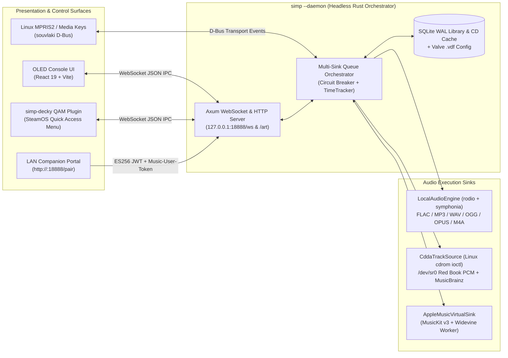

<div align="center">
  

  # Simple Integrated Media Player (decky plugin)

  **A controller-first, OLED-safe, hybrid local/cloud audio player, primarily targeted for SteamOS, Bazzite, and `gamescope` consoles.**

  [](#)
  [](#)
  [](#)
  [](#)
</div>

---

## 1. Why create this?

SIMP seeks to fill a void with media playback from within gamescope; therefore this project seeks to produce an installable artifact that can offer native feeling playback for audio across a range of sources. 


Modern Linux gaming handhelds (**Steam Deck OLED**) and living-room consoles (**SteamOS / Bazzite Steam Machines**) run inside `gamescope` (Steam Game Mode). While Game Mode excels at launching games, audio and music playback remain fragmented and hostile to a console/handheld environment:

1. **No Native Apple Music Path on SteamOS:** There is no official Apple Music client for Linux or SteamOS, and attempting to run the full Apple Music web app inside a nested desktop browser window in Game Mode is unusable with a controller, breaks background playback when closed.
2. **Ununified Audio Silos:** A player's music is split across downloaded **Steam Soundtracks (OSTs)**, local `FLAC`/`MP3` folders on SD cards or USB drives, **Apple Music** cloud streams, and—on docked/living-room Steam Machines—**physical Audio CDs** in an external USB optical drive.
3. **OLED Burn-In & Resource Bleed:** Leaving a traditional media player open on an OLED display risks static sub-pixel wear, while heavyweight desktop players waste hundreds of megabytes of RAM and keep PipeWire audio graphs awake even when paused.

**SIMP (`org.simp.player`)** solves these problems by decoupling a microscopic headless Rust audio orchestrator (`simp --daemon`) from a purpose-built **OLED Console UI** and a **Decky Loader Quick Access Menu (`simp-decky`)** drawer.

---

## 2. What SIMP does

### 2.1 Native-ish Apple Music on SteamOS
To make Apple Music feel like a built-in console service on SteamOS without an official Linux SDK:
* **Native Rust `ES256` Developer Token Engine:** `simp-core` signs Apple `MusicKit` Developer JWTs directly in Rust (`p256` ECDSA / IEEE P1363) or loads a pre-baked publisher token embedded at release time.
* **Persistent Headless Widevine Worker (`simp-widevine.service`):** When the user closes the SIMP UI to return to their game, a dedicated lightweight headless Chromium worker (`?worker=apple`) maintains the `MusicKit JS v3` Encrypted Media Extensions (EME) session so cloud tracks advance seamlessly in the background.
* **LAN QR Companion Pairing (`/pair`):** Typing Apple ID credentials and 2FA codes on a gamepad on-screen keyboard—or using FIDO2/YubiKey/Passkeys inside an embedded WebView—is painful. SIMP serves a LAN pairing portal (`http://<steamdeck-ip>:18888/pair`) via an on-screen QR code so users can authenticate on their iPhone, Android, or PC using Face ID / Touch ID / Passkeys and beam the `Music-User-Token` straight into the SteamOS daemon.

### 2.2 Apple Music Service Feeds & Full-Album Discovery
SIMP surfaces Apple Music's core discovery and library feeds directly inside the controller-navigable `📚 Library & Queue` browser:
* **`☁️ Cloud Playlists`:** Browse the user's personal iCloud Music Library playlists without cluttering the local database until explicitly pinned.
* **`📻 Radio & For You`:** One-tap tuning into Apple Music live/personal Radio stations alongside algorithmic *Made For You* mixes and *Heavy Rotation* albums.
* **`✨ New` Feed:** Browse Apple Music's *New Releases* and *Top Charts* (albums, featured playlists, and songs).
* **Unified Live Catalog Search & `💿` Full-Album Resolution:** Typing into the search bar queries local mounts and the live Apple Music catalog simultaneously. Every track—whether playing on the Lock Screen or listed in search/playlists—exposes a **`💿` Open Full Album** action that resolves the complete parent album tracklist on demand.

### 2.3 Lightweight Opt-In Pin Mechanism (`📌 Pinned in SIMP`)
Users often have hundreds of legacy playlists in their cloud account that they do not want to scroll through on a handheld console:
* **Zero-Bloat Opt-In Pinning:** Cloud playlists and full catalog albums can be previewed and played immediately, or **Pinned (`📌 Pin`)** into SIMP with a single button press.
* **Instant Offline-Indexed Startup:** Pinned items (`origin = 'apple_remote'`) have their track metadata and artwork URLs persisted in SIMP's local SQLite `WAL` database (`~/.local/share/simp/library.db`), so the `📌 Pinned in SIMP` tab loads instantaneously on boot without waiting on cloud pagination. Unpinning (`✕`) cleanly removes the cached records.

### 2.4 Comingled Local Files + Streaming Hybrid Playlists
Most media players force a hard wall between local file queues and DRM streaming queues. SIMP's Rust `Orchestrator` abstracts playback across multiple audio sinks:
* **Multi-Sink Queue Handoff:** A single queue or **`★ SIMP Hybrid Playlist` (`origin = 'simp_local'`)** can freely interleave local `FLAC`/`MP3`/`WAV`/`OGG`/`OPUS`/`M4A` files, auto-discovered **Steam Soundtracks** (parsed from `steamapps/libraryfolders.vdf`), and **Apple Music** tracks (`applemusic:song:*`).
* **Automatic Sink Switching:** As the queue advances from a local file to an Apple Music stream (or vice versa), the Rust `Orchestrator` automatically pauses the outgoing sink, initializes the incoming sink (`LocalAudioEngine` via `rodio`/`symphonia` ↔ `AppleMusicVirtualSink` over WebSocket IPC), and synchronizes `MPRIS2` metadata and 60fps progress interpolation.

### 2.5 External USB Optical Media (`cdda://`) & CDDB / MusicBrainz Integration
For docked Steam Decks and living-room Steam Machines with an attached external USB CD/DVD drive:
* **Zero-`sudo` Linux `ioctl` CD-DA Reader:** Reads Red Book Audio CD Table of Contents (`CDROMREADTOCHDR`, `CDROMREADTOCENTRY`) and streams raw 44.1 kHz 16-bit stereo PCM frames (`CDROMREADAUDIO`, 2,352 bytes/sector with automatic LBA/MSF fallback) directly from `/dev/sr0`..`/dev/sr3` into `rodio`—using standard Linux `udev` seat permissions (`uaccess` / `optical` group) with **no `sudo` required**.
* **MusicBrainz DiscID + Cover Art Archive (Modern Open CDDB):** Computes the canonical SHA-1 **MusicBrainz DiscID** and full sector-offset TOC string from the physical disc, resolves album/artist/track titles via the MusicBrainz JSON Web Service (with fuzzy TOC sector matching), downloads front cover art from the Cover Art Archive, and caches the result in SQLite (`cd_cache`) so subsequent insertions of the same disc resolve instantaneously offline.
* **No Background Drive Polling:** To prevent optical drive motor clicks, spin-up noise, and USB power drain, SIMP **never polls the optical drive in the background**. The drive is queried only on-demand (`🔄 Scan CD`) or while the user is actively viewing the CD source / Sources dialog while the app is awake.
* **Ephemeral CD Player Ergonomics:** Optical CD tracks (`cdda://`) are intentionally isolated from saved playlists (no `+ Playlist` button)—behaving like a dedicated console CD player with **Play**, **Loop/Repeat**, **true random Shuffle**, **Seek**, and **Hardware Eject (`⏏`)**.

### 2.6 OLED Burn-In Prevention & Handheld Power Engineering
Designed specifically for the Steam Deck OLED and OLED TVs:
* **True-Black (`#000000`) Pixel-Off Canvas:** Backgrounds use pure `#000000` so unlit pixels draw zero current and experience zero organic degradation.
* **8-Point `±2px` Sub-Pixel Orbit:** Every 20 seconds, the root viewport shifts along an imperceptible 8-step circular `±2px` path (`translate3d`), ensuring high-contrast borders and typography never rest on the same sub-pixels.
* **30-Second Relative Auto-Dim & True-Black Sleep Screen (`🌙`):** After 30 seconds of inactivity, UI luminance drops by 50% relative to the user's brightness setting. Users can also engage a **True-Black OLED Sleep Screen** from the Power Menu (`⏻`) that blanks the screen while keeping a protected wake-tap/button guard active.
* **60-Second PipeWire DSP Idle-Suspend:** When playback is paused for 60 seconds, `LocalAudioEngine` drops the active ALSA/PipeWire output stream handle so the system audio graph can enter deep power-save (`0.00%` idle CPU).

---

## 3. System Architecture & Technology Stack



| Layer | Technology | Role & Design Rationale |
| :--- | :--- | :--- |
| **Core Daemon (`simp-daemon`, `simp-core`)** | **Rust**, `tokio` (2-thread runtime), `mimalloc`, `axum` | Sub-15 MB RSS headless background service; serves WebSocket IPC (`/ws`), local cover art (`/art/*`), and the `/pair` web portal on port `18888`. |
| **Local & Optical Audio (`sinks/local.rs`, `sinks/cdda.rs`)** | `rodio`, `symphonia`, `lofty`, Linux `<linux/cdrom.h>` `ioctl` | Hardware-accelerated decoding, gapless-ready queue transitions, 60s PipeWire stream drop on pause, and direct `/dev/sr0` Red Book CD-DA sector streaming. |
| **Metadata & Persistence (`library/db.rs`, `library/vdf.rs`)** | `rusqlite` (`WAL` mode), `keyvalues-parser` (`.vdf`), `sha1` | Non-destructive USB/SD hotplug tracking (`mounts`), Steam `libraryfolders.vdf` soundtrack scanner, hybrid playlists, and MusicBrainz `cd_cache`. |
| **Apple Music Cryptography & DRM (`sinks/apple.rs`)** | Rust `p256` (`ES256` JWT), `MusicKit JS v3`, Chromium EME | Native Developer Token generation + persistent background Widevine worker (`simp-widevine.service`). |
| **Console UI & Decky QAM (`ui/`, `decky-plugin/`)** | **React 19**, **TypeScript**, `@simp/client`, Valve `webpackChunksteamui` | True-black OLED interface with 2D spatial gamepad navigation (`D-Pad`, `Left/Right Sticks`, `ABXY`, `L1/R1`, `L2/R2`) and native SteamOS QAM focus integration. |

---

## 4. Controller & Hardware Input Map

| Control | `🎵 Player` View (`L1`) | `📚 Library & Queue` View (`R1`) / Modals |
| :--- | :--- | :--- |
| **`A` Button / `Enter`** | Toggle Play / Pause (`⏯`) | Activate focused item, play track, or toggle button |
| **`B` Button / `Esc`** | Close active modal/popover or exit fullscreen console | Return to `🎵 Player` view or close active modal |
| **`X` Button** | Toggle Queue Shuffle (`🔀`) | Play selected Album / Playlist / CD in Shuffle mode |
| **`Y` Button** | Cycle Repeat Mode (`Off` → `Queue` → `Track`) | Cycle Repeat Mode |
| **`D-Pad Left / Right`** | Previous (`⏮`) / Next (`⏭`) Track | 2D Spatial Focus Navigation across columns |
| **`D-Pad Up / Down`** | Master Volume `+5%` / `-5%` | 2D Spatial Focus Navigation up/down lists |
| **`L1` / `R1` Bumpers** | Switch to `🎵 Player` (`L1`) / `📚 Library & Queue` (`R1`) | Switch between `🎵 Player` (`L1`) and `📚 Library & Queue` (`R1`) |
| **`L2` / `R2` Triggers** | Seek `-10s` (`⏪`) / `+10s` (`⏩`) | Seek `-10s` (`⏪`) / `+10s` (`⏩`) |
| **`Select` / `View`** | Open **Sources, Optical CD & Auth** Modal | Open/Close **Sources, Optical CD & Auth** Modal |
| **`Start` / `Menu`** | Open **Power, OLED Sleep & System** Modal (`⏻`) | Open/Close **Power, OLED Sleep & System** Modal (`⏻`) |

---

## 5. Repository Layout & Developer Quick Start

```text
simp/
├── crates/
│   ├── simp-protocol/    # Shared serde IPC commands, events, OpticalDiscStatus & TrackMetadata
│   ├── simp-core/        # Multi-sink Orchestrator, Local/CDDA/Apple sinks, SQLite/VDF indexer, MPRIS2
│   └── simp-daemon/      # Headless systemd daemon + Axum WebSocket / Artwork / Pairing HTTP server
├── src-tauri/            # Unified `simp` binary entrypoint (`--daemon` vs `--ui` / `--apple-worker`)
├── packages/simp-client/ # Shared TypeScript WebSocket SDK (`@simp/client`)
├── ui/                   # OLED Console Mode React + Vite frontend
├── decky-plugin/         # `simp-decky` SteamOS Quick Access Menu (QAM) plugin
└── scripts/              # SteamOS release packaging & one-line installer scripts
```

### Local Development (Linux / SteamOS / WSL2)

```bash
# 1. Start the headless Rust audio & IPC daemon (ws://127.0.0.1:18888/ws)
cargo run -p simp -- --daemon

# 2. Launch the OLED Console UI dev server (http://localhost:1420)
npm run dev:ui

# 3. Build production UI, Decky plugin, and run Rust test suite
npm run build:ui && npm run build:decky && cargo test --workspace
```

---

## 6. License & Trademark Disclaimer


> **Trademark & Non-Affiliation Notice:**
> **SIMP (Simple Integrated Media Player)** is an independent, third-party software project and is **not** affiliated with, endorsed by, sponsored by, or officially connected to **Valve Corporation**, **Apple Inc.**, **MetaBrainz Foundation**, or any of their subsidiaries or affiliates.
>
> * **Steam**, **SteamOS**, **Steam Deck**, and **Steam Machine** are trademarks and/or registered trademarks of **Valve Corporation** in the U.S. and/or other countries.
> * **Apple**, **Apple Music**, **MusicKit**, **iCloud**, **iPhone**, **Face ID**, and **Touch ID** are trademarks of **Apple Inc.**, registered in the U.S. and other countries and regions.
> * **MusicBrainz** and **Cover Art Archive** are trademarks of the **MetaBrainz Foundation**.
>
> All product, service, and company names mentioned in this repository are used strictly for identification and interoperability purposes (nominative fair use).

